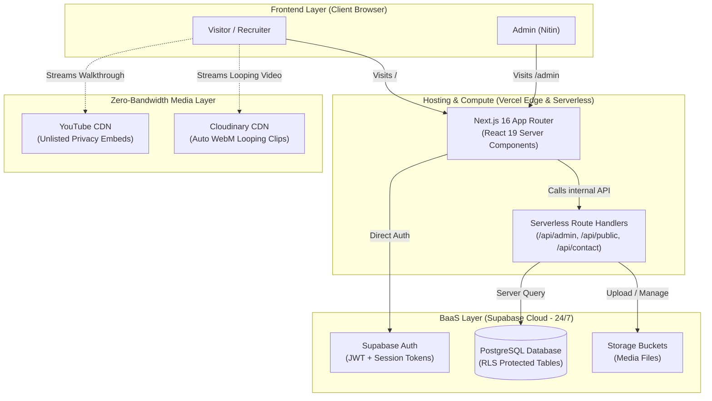

# 01. Architecture, Hosting & Zero-Cost Strategy (HOW & WHY)

> **Purpose:** This document explains the core architectural decisions behind NITINSINGHVERSE, with flowcharts, trade-offs, and presentation answers.

---

## 1. System Architecture Diagram

---

## 2. Decision: Why Vercel + Supabase instead of a Single Node/VPS Server?

| Criteria | Traditional VPS (AWS / DigitalOcean) | Free Node Hosting (Render / Koyeb) | Vercel + Supabase (Chosen) |
| :--- | :--- | :--- | :--- |
| **Cost** | \$5–\$12/month (₹500–₹1200/mo) | Free | **₹0 (Completely Free)** |
| **Cold Starts** | None (always on) | **30–50 sec sleep delay** ❌ | **Instant (Edge CDN + Serverless)** |
| **Maintenance** | Linux updates, Nginx, SSL, PM2 | Docker, manual restarts | **Zero DevOps (Push to Git = Live)** |
| **Scaling** | Fails under traffic spikes | Memory crashes | **Auto-scales to 100k+ visits** |

### The "WHY":
1. **Cold Start Problem Avoidance:** Platforms like Render sleep after 15 minutes of inactivity. When a recruiter clicks a portfolio link, waiting 40 seconds creates an immediate negative impression. Vercel static assets have 0s delay.
2. **Serverless Separation:** By using Next.js Route Handlers (`src/app/api`), we get serverless microservices for free without deploying a separate Express server.

---

## 3. Interview Q&A Cheatsheet (Viva & Presentation)

### Q: "Why did you choose a Serverless + BaaS architecture instead of an Express/Node backend?"
> **Answer:** 
> *"A portfolio requires instant availability, global low-latency CDN distribution, and zero maintenance overhead. By coupling Next.js Serverless Route Handlers with Supabase (PostgreSQL BaaS), we achieved zero-cost hosting with sub-second page loads. We avoided the traditional 30-50 second cold-start delays common in free-tier container hosting like Render, while maintaining enterprise-level security using PostgreSQL Row Level Security (RLS)."*

