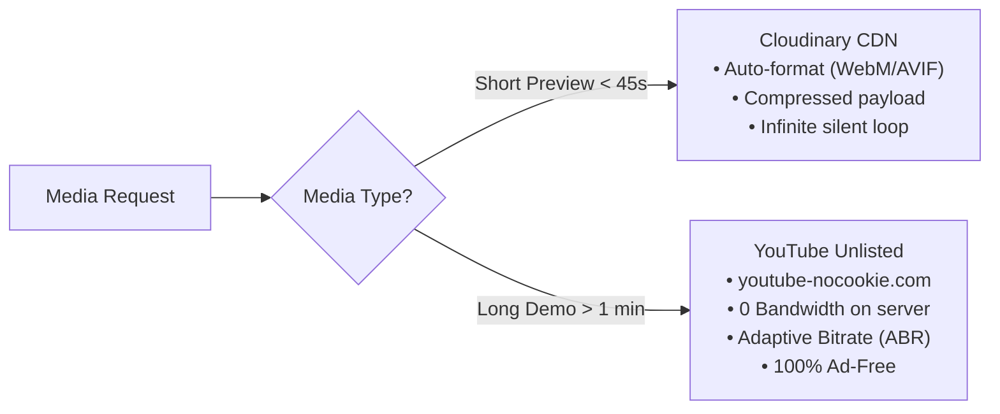

# 02. Media, Video & Asset Strategy (HOW & WHY)

> **Purpose:** Explains how heavy media (videos, 3D models, images) are served without paying for bandwidth, without buffering, and with zero ads.

---

## 1. The Core Problem with Media in Web Hosting
* Videos consume massive bandwidth. A single 1-minute 1080p MP4 file is ~30–50 MB.
* If 100 recruiters watch that video:
  $$\text{Total Bandwidth} = 100 \times 40\text{ MB} = 4\text{ GB}$$
* On Vercel (100 GB cap) and Supabase (2 GB egress cap), raw video hosting quickly hits limits or causes unexpected billing.

---

## 2. The Hybrid Solution



---

## 3. Deep Dive: Why YouTube Embeds Have NO Ads on this Portfolio

### Q: "Will ads pop up on my portfolio videos?"
**Answer:** **No, 100% ad-free.**

### The 3 "WHYs":
1. **Monetization Ineligibility (YPP):** YouTube only serves ads on channels enrolled in the YouTube Partner Program (requires 1,000 subscribers, 4,000 watch hours, and manual ad opt-in). A non-monetized developer channel receives zero ad inventory.
2. **Copyright Protection:** YouTube only inserts forced third-party ads if copyrighted background music is detected. All walkthroughs must use original developer voiceover or royalty-free audio.
3. **Privacy-Enhanced Player (`youtube-nocookie.com`):**
   ```html
   <iframe 
     src="https://www.youtube-nocookie.com/embed/{VIDEO_ID}?rel=0&modestbranding=1&controls=1" 
     allow="accelerometer; autoplay; clipboard-write; encrypted-media; gyroscope; picture-in-picture"
     allowfullscreen
   />
   ```
   - **`youtube-nocookie.com`**: Prevents Google from reading ad-tracking cookies until the user interacts, eliminating personalized ad targeting.
   - **`rel=0`**: Ensures that when the video finishes, recommendations only show videos from *your own channel*, never competitor or clickbait videos.
   - **`modestbranding=1`**: Suppresses distracting YouTube branding overlays.

---

## 4. Interview Q&A Cheatsheet

### Q: "How did you optimize video delivery and control egress costs?"
> **Answer:**
> *"Video streaming can quickly exhaust bandwidth limits. We implemented a hybrid strategy:
> 1. Short looping UI demos are compressed on-the-fly via Cloudinary into WebM/AVIF format with muted autoplay.
> 2. Full walkthroughs are offloaded to an unlisted YouTube privacy-enhanced embed (`youtube-nocookie`) with strict parameters (`rel=0`). This provides free global Adaptive Bitrate Streaming (switching seamlessly between 1080p, 720p, and mobile data) with zero egress bandwidth consumption on our Vercel or Supabase tier."*

