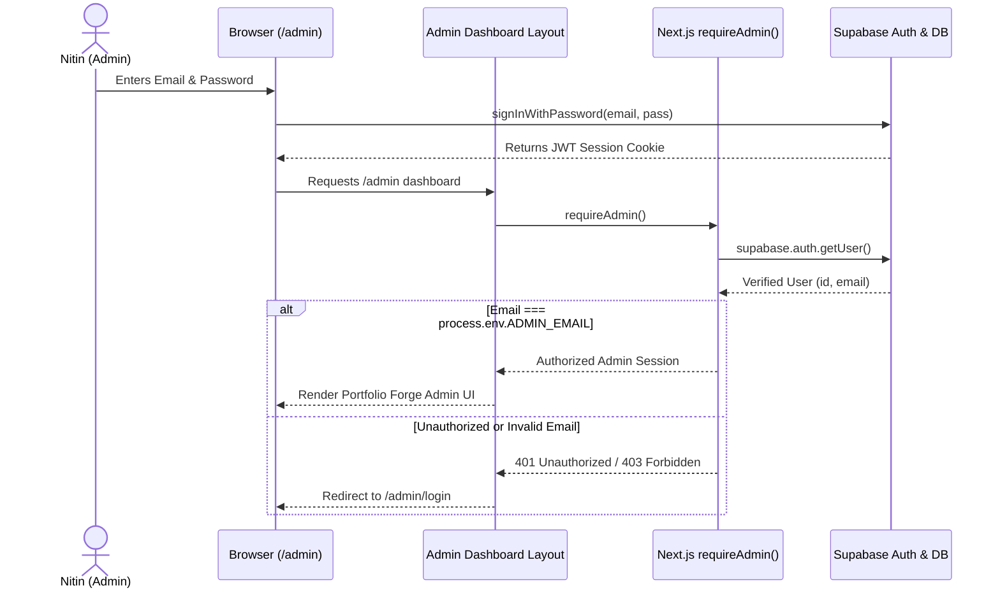

# 03. Security, Authentication & Git Strategy (HOW & WHY)

> **Purpose:** Explains security architecture, why the admin panel is secure even with open-source code, and how secrets are isolated.

---

## 1. Authentication Flow Diagram



---

## 2. Row Level Security (RLS) in PostgreSQL

### What is RLS?
In traditional backends, if someone gets your API key, they can execute `SELECT * FROM table` and steal everything.
In Supabase PostgreSQL, **Row Level Security** inspects *every single SQL query* against the currently logged-in user's identity (`auth.uid()`).

```sql
-- Example from migration 20260911183200_restrict_admin_rls.sql:
CREATE POLICY "Admin full access on projects" 
ON public.projects FOR ALL 
USING (EXISTS (SELECT 1 FROM public.admins WHERE id = auth.uid()));
```

### The "WHY":
Even if someone discovers your public anon key (`NEXT_PUBLIC_SUPABASE_ANON_KEY`), they can only read rows where `visibility = true`. They **cannot delete, update, or inspect unlisted admin data** because the database engine itself enforces the security rules at the database level!

---

## 3. GitHub Public vs Private: Security Truth

* **Secret Isolation:** All confidential values reside exclusively in `.env.local`:
  - `NEXT_PUBLIC_SUPABASE_URL`
  - `NEXT_PUBLIC_SUPABASE_ANON_KEY`
  - `ADMIN_EMAIL`
* **`.gitignore` Protection:** `.env*` is explicitly ignored, ensuring no keys or credentials ever reach GitHub.
* **Why keeping Repo Private initially is smart:**
  - Complete control over when recruiters see raw source code.
  - Allows iterating freely without exposing unfinished commits or experimental branches.
  - Vercel seamlessly deploys private repos for 100% free.

---

## 4. Interview Q&A Cheatsheet

### Q: "How is your admin panel secured against unauthorized access?"
> **Answer:**
> *"We implement defense-in-depth:
> 1. Edge/Route Level: Next.js server components verify the user's JWT session via `requireAdmin()` and compare against the environment's `ADMIN_EMAIL`.
> 2. Database Level: PostgreSQL Row Level Security (RLS) ensures that even if an API route is compromised or queried with a public client, the PostgreSQL engine blocks all non-admin write and update operations at the storage engine level."*

