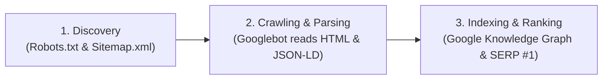

# 04. SEO, Google Search & Schema.org Strategy (HOW & WHY)

> **Purpose:** Explains how NITINSINGHVERSE is architected to rank #1 on Google Search, how Googlebot crawls Next.js sites, and how to verify with Google Search Console.

---

## 1. How Google Search Works (The 3 Stages)



1. **Discovery:** Googlebot finds your site via `sitemap.xml` and checks `robots.txt` for permissions.
2. **Crawling:** In Next.js, Server Components pre-render full HTML with meta tags on Vercel Edge. Googlebot receives instant, readable text without needing slow client-side JavaScript execution.
3. **Indexing:** Google reads the structured JSON-LD (`schema.org`) and associates the keyword **"nitinsinghverse"** with Nitin Singh.

---

## 2. Why "NITINSINGHVERSE" Ranks #1 Fast (The "WHY")

* **Zero Keyword Collision:** Common names like "John Doe" or "Rahul Sharma" face millions of competing pages. **"NITINSINGHVERSE"** is an ultra-unique branded keyword.
* **Exact Brand Match (EBM):** The title, URL (`nitinsinghverse.vercel.app`), metadata, openGraph, and headings all reinforce `nitinsinghverse`.

---

## 3. Technical SEO Pillars Implemented in Code

### A. JSON-LD Structured Data (`schema.org`)
In `src/app/layout.tsx`, we injected structured metadata that Google's algorithm parses directly into rich search results:

```json
{
  "@context": "https://schema.org",
  "@type": "Person",
  "name": "Nitin Singh",
  "alternateName": ["nitinsinghverse", "NITINSINGHVERSE", "DigiBoy1"],
  "url": "https://nitinsinghverse.vercel.app",
  "jobTitle": "AI/ML Student & Full-Stack Developer",
  "sameAs": ["https://github.com/DigiBoy1"]
}
```

### B. Dynamic Robots & Sitemap
- **`src/app/robots.ts`:** Directs Googlebot to crawl all public project pages while disallowing private admin routes (`/admin/` and `/api/admin/`).
- **`src/app/sitemap.ts`:** Automatically lists all published projects and updates whenever a new project is created in Portfolio Forge.

---

## 4. Post-Deployment: How to Get Indexed in 24 Hours

Once deployed on Vercel:
1. Open **[Google Search Console](https://search.google.com/search-console)**.
2. Click **"Add Property"** ➔ Enter your live URL (e.g., `https://nitinsinghverse.vercel.app`).
3. Verify ownership (via HTML tag or DNS).
4. In the left menu, click **"Sitemaps"** ➔ enter `sitemap.xml` ➔ click **Submit**.
5. In the top search bar, paste your homepage URL and click **"Request Indexing"**.

Googlebot will prioritize crawling your site, typically indexing it within 24–48 hours.

